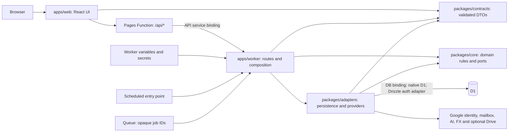
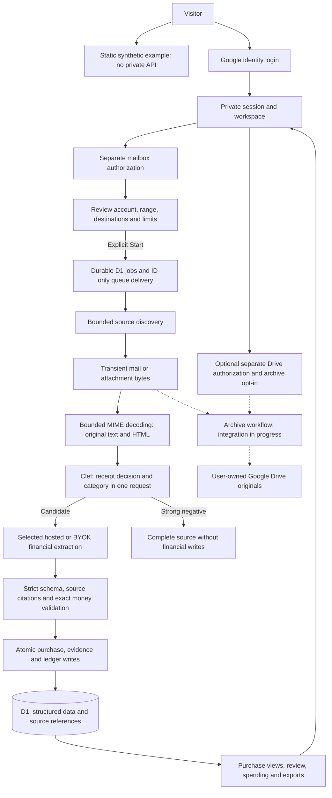

# Invoxim

Purchase records across inboxes: find receipts, inspect payment and refund evidence, and understand recorded spending. The app uses React/Vite on Cloudflare Pages, one modular Worker API, and D1. AI adapters are provider-agnostic and selected through validated server configuration.

Implementation is in progress. Local synthetic tests have been executed; they do not prove live OAuth, provider behavior or model quality. A deployment exists at [invoxim-web.pages.dev](https://invoxim-web.pages.dev/), but successful Google login and production schema readiness remain unverified. See the [task backlog](.agents/backlog.json), [manual tasks](MANUAL_TASKS.md) and [deployment checklist](DEPLOYMENT_CHECKLIST.md). Implementation evidence records are kept outside git; historical copies are in the commit history before fe99887.

## Quick start

Run commands from the repository root. Use the Node version in [.node-version](.node-version) and pnpm version pinned in [package.json](package.json).

```sh
pnpm install --frozen-lockfile --ignore-scripts
pnpm exec playwright install chromium
pnpm run dev
```

This starts the Vite frontend and local Wrangler Worker. Their default addresses are `http://localhost:5173` and `http://localhost:8787`; use the addresses printed in the terminal if ports are occupied. Open `/demo` for the static, synthetic example. Stop both processes with Ctrl+C.

Vite does not provide the production Pages service-binding proxy. Running both processes alone does not establish an authenticated local journey. Configure supported services and server secrets according to [Worker configuration](apps/worker/CONFIGURATION.md); never put credentials in frontend variables. See the [local runtime guide](tools/implementation/README.md) for filesystem overrides and test details.

## Common commands

| Command                             | Purpose                                                                                                                                |
| ----------------------------------- | -------------------------------------------------------------------------------------------------------------------------------------- |
| `pnpm run dev`                      | Start frontend and local Worker together                                                                                               |
| `pnpm --filter @invoxim/web dev`    | Start only the frontend                                                                                                                |
| `pnpm --filter @invoxim/worker dev` | Start only the local Worker                                                                                                            |
| `pnpm verify`                       | Required local gate: boundaries, secrets, dependency policy, formatting, Biome, types, unit/integration tests, build and browser tests |
| `pnpm lint:biome`                   | Check source and tests; warnings fail                                                                                                  |
| `pnpm lint`                         | Alias for `pnpm lint:biome`                                                                                                            |
| `pnpm format:check`                 | Check Prettier formatting of the derived file set (see `.prettierignore`)                                                              |
| `pnpm typecheck`                    | Typecheck workspace packages                                                                                                           |
| `pnpm test:unit`                    | Run tooling and workspace unit tests                                                                                                   |
| `pnpm test:integration`             | Run native Worker/D1 integration tests                                                                                                 |
| `pnpm test:e2e`                     | Run browser tests                                                                                                                      |
| `pnpm test:a11y`                    | Run browser cases matching `accessibility`                                                                                             |
| `pnpm test:security`                | Run the explicit adversarial test suite                                                                                                |
| `pnpm db:check`                     | Run database, pipeline and lifecycle integrity suites                                                                                  |
| `pnpm test:eval:offline`            | Run the synthetic extraction corpus; not live-model evaluation                                                                         |
| `pnpm check:deps`                   | Check dependency policy and registry advisories                                                                                        |
| `pnpm check:production`             | Inspect built publication artifacts and all three bundle inventories for test/debug tooling; requires a completed build                |
| `pnpm build`                        | Build frontend/Pages Function, dry-run the Worker bundle, and check production artifacts; does not deploy                              |

For a focused native test:

```sh
pnpm --filter @invoxim/worker exec vitest run test/auth-deployment-readiness.test.ts
```

Mutation testing, live model evaluation and a broader release verification gate are not implemented; there are no scripts for them, and passing the commands above is not release evidence. `pnpm test:eval:clef` runs the synthetic Clef classifier evaluation (dry run by default) described in [tools/implementation/clef-eval.md](tools/implementation/clef-eval.md). GitHub Actions runs verification, dependency auditing and security tests; this repository's workflow does not deploy or synchronize D1.

## Database commands

D1 configuration is in [apps/worker/wrangler.jsonc](apps/worker/wrangler.jsonc). The Worker expects binding `DB`; migrations are discovered in [packages/adapters/migrations](packages/adapters/migrations/). Remote commands require an authenticated Cloudflare account or a securely supplied `CLOUDFLARE_API_TOKEN`.

Inspect pending migrations and remote table names without reading user records:

```sh
pnpm --filter @invoxim/worker exec wrangler d1 migrations list invoxim-db --local
pnpm --filter @invoxim/worker exec wrangler d1 migrations list invoxim-db --remote
pnpm --filter @invoxim/worker exec wrangler d1 execute invoxim-db --remote --command="SELECT name FROM sqlite_schema WHERE type='table' ORDER BY name"
```

After reviewing the complete pending set and target database, the apply commands are:

```sh
# Local database only
pnpm --filter @invoxim/worker exec wrangler d1 migrations apply invoxim-db --local

# Remote database: approved migration set and backup/recovery plan required
pnpm --filter @invoxim/worker exec wrangler d1 migrations apply invoxim-db --remote
```

Apply runs all remaining discovered migrations. The migration directory includes M1 work still under integration; these commands are not approval to apply every draft. The consolidated `0001_initial.sql` initializes an empty database. Do not replay it on a populated database: follow the [baseline transition checklist](docs/runbooks/baseline-transition-checklist.md). The app does not migrate at startup, and deploying code does not synchronize the schema. See [Cloudflare D1 migrations](https://developers.cloudflare.com/d1/reference/migrations/).

## Deployment commands

Worker and Pages deployments are separate. Only compiled runtime assets are deployed; installed development dependencies and browser binaries stay on the build machine. `pnpm build` checks the browser, Pages Function and Worker module inventories for test/debug tooling, and checks the public directory for test artifacts and source maps. Inventories stay in ignored package-local `.production/` directories outside `dist`. Worker dry-run source maps remain local and source-map upload is explicitly disabled. Use a reviewed build, compatible schema, configured secrets and the [deployment checklist](DEPLOYMENT_CHECKLIST.md) before running these commands against the configured remote resources:

```sh
pnpm --filter @invoxim/worker exec wrangler login
pnpm build
pnpm --filter @invoxim/worker exec wrangler deploy
pnpm --filter @invoxim/web exec wrangler pages deploy dist --project-name invoxim-web --branch main
```

Pages forwards `/api/*` through its `API` service binding to `invoxim-api`. Confirm that binding and the Worker's `DB` binding in the deployed environment. Configure Google login separately from mailbox and Drive authorization; the exact login callback is `<AUTH_ORIGIN>/api/auth/callback/google`. Secret names and feature prerequisites are documented in [Worker configuration](apps/worker/CONFIGURATION.md).

The production Worker configuration binds `JOBS` to the existing `invoxim-jobs` Queue, consumes one message per invocation and routes exhausted deliveries to `invoxim-jobs-dlq`. Settled jobs enqueue a bounded dispatch wakeup so ready continuation stages can start in a fresh invocation without waiting for Cron. The minute Cron remains the recovery fallback; recurring mailbox checks remain hourly in D1. Gmail discovery, extraction and jobs are enabled in that configuration. Import still requires the user's explicit reviewed Start; credentials remain Wrangler secrets.

```bash
# Restore Cloudflare CLI authentication if needed
pnpm --filter @invoxim/worker exec wrangler login
# Inspect existing Queue resources and deployments
pnpm --filter @invoxim/worker exec wrangler queues list
pnpm --filter @invoxim/worker exec wrangler deployments list
# Inspect background events without publishing log contents
pnpm --filter @invoxim/worker exec wrangler tail invoxim-api
```

These commands are operator instructions, not a record of deployment. CLI syntax is checked against pinned Wrangler and its [command documentation](https://developers.cloudflare.com/workers/wrangler/commands/); Pages upload details are in [Direct Upload](https://developers.cloudflare.com/pages/get-started/direct-upload/).

## Modules

The Worker composition root selects concrete adapters from validated variables, secrets and bindings. Core logic stays independent of vendor SDKs and environment reads. Diagram arrows show dependencies or runtime connections; provider availability is separately gated.



| Path                                      | Responsibility                                                                          |
| ----------------------------------------- | --------------------------------------------------------------------------------------- |
| [apps/web](apps/web/)                     | Landing/example, onboarding and private workspace; Pages API forwarding                 |
| [apps/worker](apps/worker/)               | Authentication, validated routes, runtime composition, scheduled and queue entry points |
| [packages/contracts](packages/contracts/) | Shared request/response schemas and copy contracts                                      |
| [packages/core](packages/core/)           | Money, evidence, authorization, extraction validation and workflow rules                |
| [packages/adapters](packages/adapters/)   | Tenant repositories, migrations and concrete external-service adapters                  |
| [test-design](test-design/)               | Acceptance requirements and synthetic fixtures                                          |
| [.agents](.agents/)                       | Canonical rules, specialist skills, backlog and review templates                        |

## Data flow

This describes the approved flow and current module boundaries, not proof of deployed completion. Gmail and Outlook processing are composed in the Worker. Outlook remains disabled by default until Microsoft registration and live personal/work-account smoke checks pass. Drive queue/backfill integration and full-period FX reporting retain their separate release gates.



Login and mailbox callbacks do not authorize scanning. AI has no tools or direct database/mailbox access, and a chosen destination is never silently replaced. Full message bodies, document text and model transcripts are transient; persisted credentials are encrypted. Original documents are retained only in explicitly authorized user-owned Drive storage. There is no R2 archive.

## Project references

Start with [START_HERE.md](START_HERE.md) and [AGENTS.md](AGENTS.md) for implementation work. [BLUEPRINT.md](BLUEPRINT.md) defines scope; [architecture](docs/02-architecture.md), [data model](docs/03-data-model.md), [API contracts](docs/12-api-contracts.md) and [onboarding](docs/13-presentation-and-onboarding.md) define detailed behavior. [Release gates](docs/10-decisions-and-release-gates.md) and the operator checklists distinguish local evidence from live readiness.

## AI provider configuration

Newly staged emails send their original decoded text and HTML alternatives together as one model input. Clef decides whether the message contains purchase evidence and categorizes it; the selected hosted or BYOK model interprets all receipt fields. The app checks output structure, real calendar dates, exact monetary precision, source-part citations and cash-event consistency; it does not parse receipt language or demand that normalized values appear literally in raw HTML. Raw content stays transient. Missing facts remain reviewable. Supported text PDFs use bounded local conversion before classification. Images and unsupported PDF formats remain reviewable; native binary input to Luna is not enabled until endpoint support is verified. Already staged legacy documents retain their previous input, and paid attempts are reused or held for review rather than charged again.

Email classification uses Cloudflare Clef before financial extraction. One request asks whether each readable document contains invoice/receipt evidence, its document type and category. Order acknowledgements and delivery notices alone do not qualify. Valid uncertainty can be verified by the same selected, metered financial model; classifier errors cannot bypass the gate. Financial output must identify an invoice, receipt, credit note or completed refund before purchase reconciliation.

The operator default is Abacus RouteLLM with fixed model `gpt-6-luna`; BYOK remains supported. Provider choices are server configuration, not frontend constants:

| Setting                                                 | Location                                                      |
| ------------------------------------------------------- | ------------------------------------------------------------- |
| Provider endpoints, models, notices and verified prices | Server preset `config/ai.abacus.production.json` → `registry` |
| Operator-funded destination/model                       | Server preset → `variables`                                   |
| Hosted API credential                                   | Worker secret `AI_HOSTED_KEY`                                 |
| Allowance and cost caps                                 | Server preset → `budget`                                      |
| User mode/provider/model and encrypted BYOK credential  | D1 `ai_settings`, using the server `CREDENTIAL_KEYRING`       |

[The production preset](config/ai.abacus.production.json) is the readable source for the selected provider, processor notices, verified tariff and approved application budget ($1/day, $10/month). The inactive [preparation template](config/ai.abacus.example.json) remains an example. The Worker imports this JSON directly into its server bundle for API, scheduled and queue handling. Edit it, run `pnpm verify`, then redeploy the Worker. No generation step or copied AI settings in Wrangler is required. Secrets remain external; explicit environment overrides are still supported and validated when intentionally supplied.

Missing or unusable provider usage metadata does not reject otherwise valid output. The adapter emits `ai_usage_unavailable` and retains conservative reserved usage/cost; it never treats missing accounting as zero cost.

Configure the key securely on the intended Worker:

```sh
pnpm --filter @invoxim/worker exec wrangler secret put AI_HOSTED_KEY
```

The CLI prompts for the value; never put it in a command argument, repository file or chat. See [Worker configuration](apps/worker/CONFIGURATION.md) for activation prerequisites.

### Email classification configuration

The Worker reads `config/ai.classification.production.json` directly. The `AI` Workers AI binding supplies Clef; no Cloudflare API key is embedded in the file. Classification is mandatory whenever processing is enabled. Missing or disabled classification, or a missing `AI` binding, blocks processing instead of bypassing the gate. `AI_CLASSIFICATION_JSON` may override the bundled classifier settings but cannot disable the required stage. Tests use synthetic classifier bindings and do not call the remote model.

Clef answers receipt likelihood, financial document type and spending category in one request. The 0.1 negative and 0.9 positive boundaries remain conservative routing defaults. Confident nonfinancial types are excluded unless the receipt answer strongly contradicts them. Plausible uncertainty uses the already-selected financial provider when `uncertainAction` is `extract` in the classifier config file; `review` preserves review-only routing. Invalid responses, outages and input-limit failures never escalate. The extraction model must also identify an invoice, receipt, credit note or refund before a purchase can be accepted. Classification never establishes payment or refund facts. Caches are per document and versioned policy; one attachment cannot qualify its covering email. These cutoffs are not calibrated accuracy guarantees.

Classification is operator funded even when financial extraction uses BYOK. It consumes the same token and USD budget ledgers, preserves conservative charges for missing usage, and does not double-count the document allowance. The existing application caps remain USD 1/day and USD 10/month.

Rollout checklist: run `pnpm verify`, deploy the Worker and web bundle together, and obtain a new processing review/Start approval that includes Cloudflare classification. Existing consent digests do not authorize the additional processor. After renewed Review/Start, Cron recovery rebinds unpaid jobs; compatible completed classification and financial caches are reused without another model charge. Paid stages with a genuinely changed processing digest, unfinished attempts or invalid cache remain paused for review. Completed or reviewed messages are not automatically reclassified or billed again. No database migration is required. Clef classification is deployed. Runtime counters confirm calls and source decisions, but deterministic tests and aggregate live counters do not establish real-model classification accuracy.

Review cards identify the connected inbox and source received time. **Show source email** requests bounded subject, sender and attachment metadata on demand from the owned Gmail or Outlook connection; metadata is transient and never stored. Gmail supports an original-email search by RFC822 Message-ID. Outlook original-email links are currently unavailable. Source inspection checks tenant ownership, connection generation, scopes, credentials and processing consent before provider reads and again before returning data. Missing details are shown separately from failed/unsupported source processing.

### Bounded document handling and uncertain verification

Oversized HTML is reduced to inert visible source text before applying the existing text cap. Complete readable text can continue; genuinely truncated excerpts remain review-only. Bodies and attachments have independent 24,000-character text budgets within unchanged source-byte, MIME-part and page limits, so a long covering email does not discard a readable invoice PDF. Common classic PDF nested passive dictionaries and legal CR stream endings are supported. Oversized source bytes, scanned PDFs, unsupported codecs and object/xref streams remain explicit limitations.

Classifier policy/config and processing notice are versioned for this change. Renew Review/Start after an approved rollout; no mailbox processing begins by saving settings. Uncertain verification uses the selected hosted/BYOK provider and existing reservations/caps, which can increase financial-model calls. Missing usage retains conservative accounting. Inert `tool_calls: null` / `function_call: null` response fields are accepted; actual tool calls remain rejected. Prompt v6 and bounded validation-code logs improve response-contract diagnostics without storing raw content.
