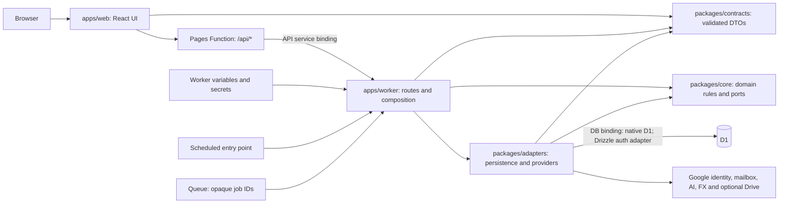
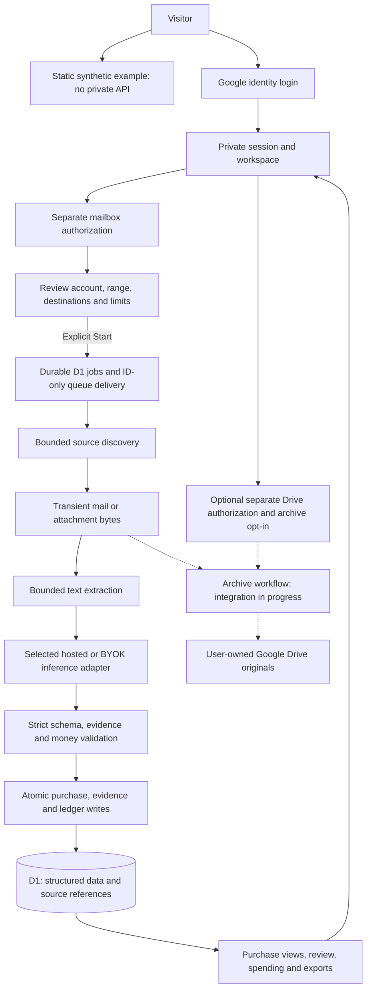

# Invoxim

Purchase records across inboxes: find receipts, inspect payment and refund evidence, and understand recorded spending. The app uses React/Vite on Cloudflare Pages, one modular Worker API, and D1. AI adapters are provider-agnostic and selected through validated server configuration.

Implementation is in progress. Local synthetic tests have been executed; they do not prove live OAuth, provider behavior or model quality. A deployment exists at [invoxim-web.pages.dev](https://invoxim-web.pages.dev/), but successful Google login and production schema readiness remain unverified. See the [task backlog](.agents/backlog.json), [implementation evidence](evidence/implementation/), [manual tasks](MANUAL_TASKS.md) and [deployment checklist](DEPLOYMENT_CHECKLIST.md).

## Quick start

Run commands from the repository root. Use the Node version in [.node-version](.node-version) and pnpm version pinned in [package.json](package.json).

```sh
pnpm install --frozen-lockfile --ignore-scripts
pnpm exec playwright install chromium
pnpm run dev
```

This starts the Vite frontend and local Wrangler Worker. Their default addresses are `http://localhost:5173` and `http://localhost:8787`; use the addresses printed in the terminal if ports are occupied. Open `/demo` for the static, synthetic example. Stop both processes with Ctrl+C.

Vite does not provide the production Pages service-binding proxy. Running both processes alone does not establish an authenticated local journey. Configure supported services and server secrets according to [Worker configuration](apps/worker/CONFIGURATION.md); never put credentials in frontend variables. See the [local runtime guide](tools/implementation/README.md) for filesystem overrides and test details.

## Common commands

| Command                                | Purpose                                                                                                                                        |
| -------------------------------------- | ---------------------------------------------------------------------------------------------------------------------------------------------- |
| `pnpm run dev`                         | Start frontend and local Worker together                                                                                                       |
| `pnpm --filter @invoxim/web dev`       | Start only the frontend                                                                                                                        |
| `pnpm --filter @invoxim/worker dev`    | Start only the local Worker                                                                                                                    |
| `pnpm verify`                          | Required local gate: boundaries, secrets, dependency policy, formatting, Biome, ESLint, types, unit/integration tests, build and browser tests |
| `pnpm lint:biome`                      | Check source and tests; warnings fail                                                                                                          |
| `pnpm lint`                            | Run ESLint                                                                                                                                     |
| `pnpm format:check`                    | Check configured Prettier targets                                                                                                              |
| `pnpm exec prettier --check README.md` | Check this README's formatting                                                                                                                 |
| `pnpm typecheck`                       | Typecheck workspace packages                                                                                                                   |
| `pnpm test:unit`                       | Run tooling and workspace unit tests                                                                                                           |
| `pnpm test:integration`                | Run native Worker/D1 integration tests                                                                                                         |
| `pnpm test:e2e`                        | Run browser tests                                                                                                                              |
| `pnpm test:a11y`                       | Run browser cases matching `accessibility`                                                                                                     |
| `pnpm test:security`                   | Run the explicit adversarial test suite                                                                                                        |
| `pnpm db:check`                        | Run database, pipeline and lifecycle integrity suites                                                                                          |
| `pnpm test:eval:offline`               | Run the synthetic extraction corpus; not live-model evaluation                                                                                 |
| `pnpm check:deps`                      | Check dependency policy and registry advisories                                                                                                |
| `pnpm build`                           | Build frontend/Pages Function and dry-run the Worker bundle; does not deploy                                                                   |

For a focused native test:

```sh
pnpm --filter @invoxim/worker exec vitest run test/auth-deployment-readiness.test.ts
```

`pnpm test:mutation`, `pnpm test:eval:live` and `pnpm verify:release` are explicit unimplemented gates. Their presence is not release evidence. GitHub Actions runs verification, dependency auditing and security tests; this repository's workflow does not deploy or synchronize D1.

## Database commands

D1 configuration is in [apps/worker/wrangler.jsonc](apps/worker/wrangler.jsonc). The Worker expects binding `DB`; migrations are discovered in [packages/adapters/migrations](packages/adapters/migrations/). Remote commands require an authenticated Cloudflare account or a securely supplied `CLOUDFLARE_API_TOKEN`.

Inspect pending migrations and remote table names without reading user records:

```sh
pnpm --filter @invoxim/worker exec wrangler d1 migrations list invoxim-db --local
pnpm --filter @invoxim/worker exec wrangler d1 migrations list invoxim-db --remote
pnpm --filter @invoxim/worker exec wrangler d1 execute invoxim-db --remote --command="SELECT name FROM sqlite_schema WHERE type='table' ORDER BY name"
```

After reviewing the complete pending set and target database, the apply commands are:

```sh
# Local database only
pnpm --filter @invoxim/worker exec wrangler d1 migrations apply invoxim-db --local

# Remote database: approved migration set and backup/recovery plan required
pnpm --filter @invoxim/worker exec wrangler d1 migrations apply invoxim-db --remote
```

Apply runs all remaining discovered migrations. The migration directory includes M1 work still under integration; these commands are not approval to apply every draft. The consolidated `0001_initial.sql` initializes an empty database. Do not replay it on a populated database: follow the [baseline transition checklist](evidence/implementation/baseline-transition-checklist.md). The app does not migrate at startup, and deploying code does not synchronize the schema. See [Cloudflare D1 migrations](https://developers.cloudflare.com/d1/reference/migrations/).

## Deployment commands

Worker and Pages deployments are separate. Use a reviewed build, compatible schema, configured secrets and the [deployment checklist](DEPLOYMENT_CHECKLIST.md) before running these commands against the configured remote resources:

```sh
pnpm --filter @invoxim/worker exec wrangler login
pnpm build
pnpm --filter @invoxim/worker exec wrangler deploy
pnpm --filter @invoxim/web exec wrangler pages deploy dist --project-name invoxim-web --branch main
```

Pages forwards `/api/*` through its `API` service binding to `invoxim-api`. Confirm that binding and the Worker's `DB` binding in the deployed environment. Configure Google login separately from mailbox and Drive authorization; the exact login callback is `<AUTH_ORIGIN>/api/auth/callback/google`. Secret names and feature prerequisites are documented in [Worker configuration](apps/worker/CONFIGURATION.md).

These commands are operator instructions, not a record of deployment. CLI syntax is checked against pinned Wrangler and its [command documentation](https://developers.cloudflare.com/workers/wrangler/commands/); Pages upload details are in [Direct Upload](https://developers.cloudflare.com/pages/get-started/direct-upload/).

## Modules

The Worker composition root selects concrete adapters from validated variables, secrets and bindings. Core logic stays independent of vendor SDKs and environment reads. Diagram arrows show dependencies or runtime connections; provider availability is separately gated.



| Path                                      | Responsibility                                                                          |
| ----------------------------------------- | --------------------------------------------------------------------------------------- |
| [apps/web](apps/web/)                     | Landing/example, onboarding and private workspace; Pages API forwarding                 |
| [apps/worker](apps/worker/)               | Authentication, validated routes, runtime composition, scheduled and queue entry points |
| [packages/contracts](packages/contracts/) | Shared request/response schemas and copy contracts                                      |
| [packages/core](packages/core/)           | Money, evidence, authorization, extraction validation and workflow rules                |
| [packages/adapters](packages/adapters/)   | Tenant repositories, migrations and concrete external-service adapters                  |
| [test-design](test-design/)               | Acceptance requirements and synthetic fixtures                                          |
| [.agents](.agents/)                       | Canonical rules, specialist skills, backlog and review templates                        |

## Data flow

This describes the approved flow and current module boundaries, not proof of deployed completion. Gmail processing is composed in the Worker; complete Outlook processing, Drive queue/backfill integration and full-period FX reporting remain in progress.



Login and mailbox callbacks do not authorize scanning. AI has no tools or direct database/mailbox access, and a chosen destination is never silently replaced. Full message bodies, document text and model transcripts are transient; persisted credentials are encrypted. Original documents are retained only in explicitly authorized user-owned Drive storage. There is no R2 archive.

## Project references

Start with [START_HERE.md](START_HERE.md) and [AGENTS.md](AGENTS.md) for implementation work. [BLUEPRINT.md](BLUEPRINT.md) defines scope; [architecture](docs/02-architecture.md), [data model](docs/03-data-model.md), [API contracts](docs/12-api-contracts.md) and [onboarding](docs/13-presentation-and-onboarding.md) define detailed behavior. [Release gates](docs/10-decisions-and-release-gates.md) and the operator checklists distinguish local evidence from live readiness.
