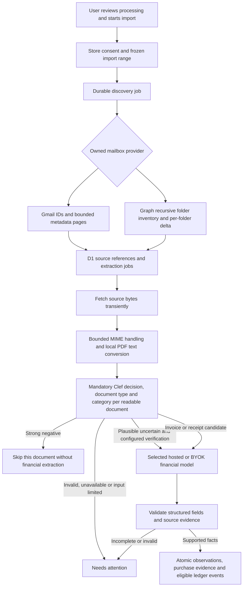

# Email fetch and purchase detection flow

This describes the local Gmail and Outlook Worker composition. Outlook processing requires explicit OAuth and discovery configuration and remains disabled by default pending live release checks. Originals and full message/model contents stay transient unless the user explicitly enables their own Drive archive.

## Discovery and processing

Signing in and connecting a mailbox do not authorize scanning. Start binds the mailbox, frozen interval, processing destinations, current settings and background authorization. Recent history runs first within the full selected interval; the older slice continues afterward.

Discovery jobs page through Gmail IDs and metadata or Outlook recursive folder inventories and per-folder deltas, save resumable cursors, and enqueue deduplicated source work. Outlook uses immutable message IDs and preserves opaque continuation URLs. Each later hourly cycle requeues existing live folders without clearing their delta cursors and discovers newly added nested folders. Production Graph discovery currently uses one-item pages to fit the measured 40-statement invocation budget; this trades throughput for bounded work without narrowing the selected date range. The queue consumer loads trusted tenant/connection/consent state and claims a fenced lease. Cron dispatch recovers eligible durable work; queue delivery itself does not prove completion.

Implementation: `apps/worker/src/index.ts`, `discovery-runtime.ts`, `job-runtime.ts`; `packages/adapters/src/discovery/` and `packages/core/src/jobs/`.

## Document handling and classification

The production pipeline requires Clef. `apps/worker/src/pipeline-runtime.ts` declines to compose an extraction handler when classification configuration or the Workers AI binding is unavailable.

The core extractor handles bounded plain/HTML email bodies and invokes the existing local PDF converter for supported text PDFs. The PDF converter accepts a restricted conventional subset, including bounded Flate compression; scanned/image-only, encrypted, ambiguous and unsupported PDFs remain explicit review cases. It does not fetch remote assets or perform OCR. See `packages/core/src/documents/extractor.ts` and `packages/adapters/src/documents/pdf.ts` / `pdf-preflight.ts`.

Each readable document receives an independent Clef request. Only that document's text is supplied. The category and completed classification cache bind its identity/hash and current configuration; an attached invoice cannot qualify a delivery covering email, and a negative email cannot discard its invoice attachment.

The typed request asks for a receipt/invoice decision and a category. Actual invoices, receipts, credit notes and completed refunds are candidates; order confirmations, delivery updates and pending refunds alone are excluded by the classification policy. With the current configuration, scores at or below 0.1 are negative, at or above 0.9 are candidates, and intermediate scores require review. These are configured routing thresholds, not measured accuracy or financial evidence. The frozen synthetic evaluation is in `tools/implementation/clef-eval.md`; live evaluation requires separate spending authorization.

Implementation: `packages/adapters/src/ai/clef-protocol.ts`, `classifier-factory.ts`, `packages/core/src/ai/classification.ts`, and `packages/adapters/src/pipeline/service.ts` / `repository.ts`.

## Financial extraction and completion

After a positive classification, the selected hosted or BYOK model extracts structured purchase fields from bounded document text. Local conversion supplies text; it does not substitute a separate financial parser for the model. The application validates the returned schema and source evidence, uses exact monetary values, distinguishes invoices from payments and completed refunds, and preserves user overrides and existing valid facts.

Processing is staged as parse, infer and reconcile, with durable continuations and cached model results. Source completion waits for sibling documents; unreadable documents and unresolved reviews remain visible. Negative documents avoid the financial-model call. A retry must pass current lease, tenant, consent, connection, credential and settings guards before writing.

AI defaults are read directly from versioned `config/` files at the Worker composition root. Keys remain Wrangler secrets. The financial destination is explicit and never silently switched. Clef has no tools, mailbox access or database access. Persisted results contain validated fields, hashes and structured provenance, not full source text, evidence quotes or model transcripts.

For broader contracts see [architecture](02-architecture.md), [mail and storage](04-email-and-storage.md), and [AI and evaluations](05-ai-and-evaluations.md).

Oversized body text no longer automatically discards independently readable attachments. Complete visible HTML text may continue under the existing bound; selected but truncated content remains explicitly reviewable. Same-provider uncertain verification reuses normal reservations, authority fences and cache handling. A financial document-type guard runs for fresh extraction, cached results and durable reconciliation, so a nonfinancial result cannot create a purchase through a continuation. No model tools, new destination, raw-content persistence or unmetered repair call is introduced.
