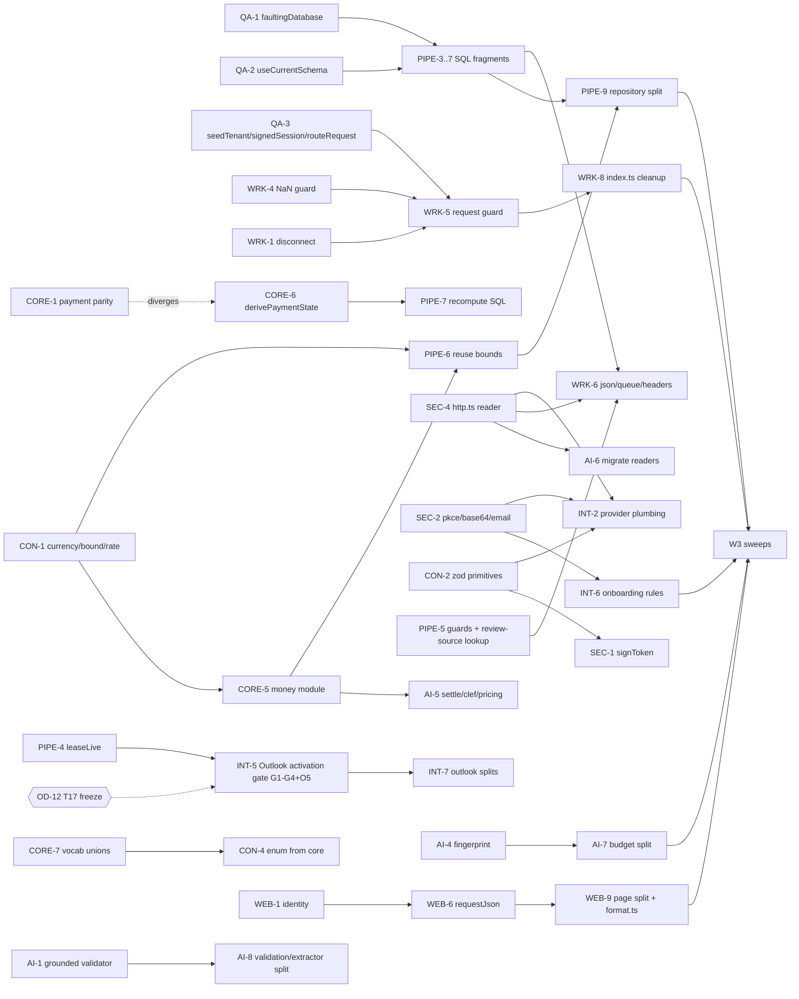

# Invoxim code-quality review: parallel-agent handover plan

**Baseline: HEAD 33afa0e** (re-validated read-only; previously 9f6ee63 before the Outlook landing).
Status of this file: execution contract for coding agents. No product redesign.

The main problem is **one business rule hand-copied in 3–10 places, with the copies already drifting apart**. The copies are SQL guards, money and settlement rules, auth guards, and token and OAuth helpers. Two secondary problems: test-only copies of money logic that create false coverage, and a few god files. Most fixes are small named functions or constants, not new layers. That matches AGENTS.md: no DI framework, no generic repository, YAGNI.

## Evaluation of the external feedback (merged)

| External correction | Verdict | Effect |
|---|---|---|
| ext#22: `document-review` *is* produced, at pipeline/repository.ts:1336, as `operational` scope | **Accepted.** My earlier "no producer" note came from a truncated grep. | It no longer counts as drift. It becomes owner decision **OD-2**: should an *operational* document review block financial restoration? Today only `financial` scope blocks it (core/corrections/validation.ts:165). |
| The tracing flag has been closed since faac350 (`AI_TRACING_INCLUDE_CONTENT: "false"`) | **Accepted** | Removed from the out-of-scope list. |
| The WIP gate is stale; the tree is clean at 9f6ee63 | **Accepted** | All [WIP] tags are dropped. Ground rule G5 replaces them. |
| Its own list keeps my backbone, shadowed routes at the top, check-boundaries over ESLint, and K5 cycle visibility | **Accepted** | No reordering is needed beyond the parallel lanes below. |

### Outlook connector landing (T17) merged into this plan

These six commits landed after the first review: 66c59c9, 092bfa9, 1e09395, 24488b8, 33afa0e, plus their evidence record. They added:

- `mailbox-runtime.ts`, a single Gmail/Outlook job router, and `mailboxProcessingConfiguration`, a shared readiness rule;
- provider-neutral `createMailboxManagement` (list and disconnect);
- Outlook review metadata in `purchase-views/review-source.ts` and the new `outlook-review-metadata.ts`;
- `refreshInventory` and hourly requeue;
- a Graph page size of 1;
- Outlook buttons in onboarding.

T17 is still **"review" in backlog.json**. Live gates are pending and Outlook is disabled by default (`OUTLOOK_ENABLED: "false"`).

Effect on this plan (findings O1–O14 in the appendix):

| Effect | Cards |
|---|---|
| Resolved or narrowed | WRK-7 (one readiness predicate now exists, so it becomes verify-and-close) and WRK-2 (narrowed) |
| Corrected | OD-4 and HYG-2: `review-source.ts` is production code and must not be deleted. OD-1 now conflicts with 24488b8. |
| Still live, now with false confidence | WRK-1: the new `outlook-disconnect.test.ts` exercises the mailbox sub-app, not the composed worker. |
| New drift | O5: Outlook budget shortfall returns `retry/transient` at 16 sites, while Gmail returns `paused/budget` (OD-11). O2/O3: new raw provider SQL in worker src. |
| Grown scope | QA-2/3/4 (3 new suites), INT-2, INT-5, INT-7, SW-2, WEB-3/5/8, TOOL-6 |
| New coordination rules | G-T17 (T17 freeze) and G-40 (40-statement budget) |

---

## Ground rules for every agent (read before taking a card)

*Naming: cards cite ground rules as "rule G1" … "rule G9", "G-T17" and "G-40". A bare G1–G12 in a card means the Gmail/Outlook appendix finding.*

- **G1. Isolation.** Each lane runs in its own git worktree on branch `refactor/<lane>`, cut from `main`. Worktrees live under `.worktrees/<lane>`.
- **G2. Commits.** The agent commits on its own lane branch, one commit per card, staging files by name.
  - The orchestrator merges lane branches into `main` in wave order, after the card's done-when check passes on the merged result.
  - No push and no PR unless the owner asks.
  - When an upstream card lands, downstream lanes rebase.
- **G3. Test first.** Cards tagged **[$]** (money) or **[T]** (tenant/security) start with a RED test that reproduces the problem. Paste the failing output into the card's commit message. Then fix, then GREEN.
- **G4. Unverified cards.** A card marked *unverified* starts by reproducing the finding. If it does not reproduce, close the card with that evidence instead of changing code.
- **G5. Clean start.** Commit or stash before a large refactor. No uncommitted work at a card's start.
- **G6. Hot files have one writer per wave.** Only the lane listed may edit a hot file in that wave. Any other lane that needs a change there either waits for a card that depends on the owner's card, or asks the owner.

  | Hot file | W0 | W1 | W2 | W3 |
  |---|---|---|---|---|
  | `apps/worker/src/index.ts` | WRK | WRK | WRK | SWEEP |
  | `packages/core/src/index.ts` | CORE | CORE | CORE | SWEEP |
  | `packages/adapters/src/index.ts` | INT | PIPE | PIPE | SWEEP |
  | `packages/contracts/src/primitives.ts` | CON | CON | CON | SWEEP |
  | `packages/adapters/src/pipeline/repository.ts` | PIPE | PIPE | PIPE | SWEEP |
  | root `package.json`, `pnpm-lock.yaml` | TOOL | TOOL | TOOL | SWEEP |

  - **Handoff edge.** Waves are labels, not barriers. A card that writes a hot file depends on the previous owner's last card on that file. Example: HYG-2 depends on INT-1.
  - **Facade rule.** A card that splits or moves a module keeps the old module path as a re-exporting facade, so the package barrels (`core/src/index.ts`, `adapters/src/index.ts`) do not change. SW-3 removes the facades.
  - **New exports.** A card that adds a new helper to a package root (for example SEC-1/SEC-4 helpers the worker imports) asks the barrel owner of that wave to add the line. The consumer card depends on that addition.
  - **Lockfile.** Only TOOL changes dependencies or root scripts. QA-5 (testkit package) depends on TOOL-1..3.

- **G7. Protect the fault injectors.**
  - X7 fault injectors match on the *leading SQL text* (see appendix X7).
  - A card that edits SQL before **QA-1** lands must leave each edited statement's leading text unchanged.
  - It must also run `rg -n "<statement prefix>" packages/*/test apps/*/test` to find the injectors it could disarm.
  - Otherwise the card depends on QA-1.
- **G8. Cross-cutting sweeps run last, one at a time (W3).** They touch about 20–30 files across lanes. Re-run the dead-code sweep at that point, because earlier cards change usage.
- **G9. Appendix IDs are the specification.** Cards cite IDs such as `P2` or `ext#12` rather than copying the finding. Read the appendix entry before starting.
- **G-T17. T17 freeze (OD-12).** Until OD-12 is answered, refactor lanes must not edit these files, because the owner may still be committing T17 fixes:
  - `discovery/outlook-*`
  - `apps/worker/src/mailbox-runtime.ts`
  - `mailbox/service.ts`
  - `purchase-views/{review-source,outlook-review-metadata}.ts`

  Cards that touch them (INT-2's mailbox part, INT-5, INT-7, WRK-6's runtime SQL) wait at the back of their lane.
- **G-40. The 40-statement budget is a binding invariant.** The Outlook runners were tuned to the physical D1 budget of 40 statements, which is why checkpoints were removed and the Graph page size is 1.
  - Any card that consolidates guards on those paths (PIPE-3/4/5, INT-5, INT-7, WRK-6) must not add statements.
  - It must keep the `outlook-runtime.test.ts` "within 40 statements" assertions green.
  - QA-4's switch to upper bounds keeps 40 as the cap.
  - No card may "restore" the removed checkpoints. The T17 security reviewer accepted that trade-off, and it is outside the redundancy scope.

**Card fields:** ID · task (refs) · write-set · depends-on · blocked-by (OD) · size (S < ½ day, M ≈ 1 day, L > 1 day). An OD-blocked card goes to the **back** of its lane, so the lane doesn't stall on it.

**Default done-when for every card:**

1. `pnpm --filter <pkg> exec vitest run <touched tests>` is green.
2. `pnpm typecheck` and `pnpm lint` pass.
3. `pnpm verify` passes before the merge to `main`.

Additions:

- **[T] cards:** also run `pnpm test:security`.
- **Web cards:** also run `pnpm test:e2e` and `pnpm test:a11y`.
- **Behaviour-neutral refactors:** the test count before and after must match, or the difference must be explained.

---

## Lanes (one agent each; cards inside a lane run in order)

| Lane | Suggested agent | Owns (write-set root) |
|---|---|---|
| **QA** | ledger-qa | `apps/worker/test/support/**`, `packages/*/test/support/**`, `packages/testkit/**`, test-only refactors of existing suites |
| **WRK** | ledger-backend | `apps/worker/src/**` |
| **PIPE** | ledger-database | `packages/adapters/src/{pipeline,jobs,purchase-views,lifecycle,corrections,fx,recurring}/**`, **except** the token files owned by SEC |
| **CORE** | ledger-backend (second instance) | `packages/core/src/**`, **except** `core/src/ai/**` and `core/src/documents/**` |
| **AI** | ledger-ai | `packages/adapters/src/ai/**`, `packages/core/src/{ai,documents}/**` |
| **SEC** | ledger-backend; ledger-security reviews it | `packages/adapters/src/{security,auth}/**`, new `adapters/src/http.ts`, plus `onboarding/token.ts`, `corrections/workspace-token.ts`, `fx/period-signing.ts` |
| **INT** | ledger-integrations | `packages/adapters/src/{mailbox,drive,discovery,onboarding}/**` (except `onboarding/token.ts`) |
| **CON** | ledger-backend | `packages/contracts/src/**` |
| **WEB** | ledger-frontend | `apps/web/**` |
| **TOOL** | ledger-cloudflare | `tools/**`, root config, `.github/**`, docs, `.gitignore`, `wrangler.jsonc` |
| **SWEEP** | orchestrator, serial | W3 cross-cutting cards |

**Ownership of shared helpers:** when lane A *defines* a shared helper, each lane *migrates its own call sites* in a later card that depends on A's card. Example: SEC writes `http.ts`, then INT, AI, WRK and PIPE each migrate their own readers.

---

## Owner decisions (queue; answer any time; blocked cards wait at the back of their lane)

| OD | Question | Recommended default | Blocks |
|---|---|---|---|
| OD-1 | Who owns `DELETE /api/connections/:id`? Today lifecycle (index.ts:133) shadows mailbox (:135) and returns 503 while `LIFECYCLE_ENABLED` is false. **Conflict:** 24488b8 deliberately made the mailbox copy provider-neutral and independent of OAuth. | **Mailbox owns plain disconnect** and keeps 24488b8's work. Lifecycle keeps delete-data under a distinct path, or yields this route when its flag is off. Alternative: lifecycle owns it regardless of the flag because its auth is stronger (recent-auth and workspace token), which reverts 24488b8. | WRK-1 fix (not its RED test) |
| OD-2 | Should an open **operational** `document-review` (repository.ts:1336) block financial restoration? | **No.** Keep the current behaviour, document it in a test, and derive the contract enum from core. | CORE-7, CON-4 |
| OD-3 | What were `overriddenFields` meant to cover ("total" checks are dead; currency override treated 2 ways: plan.ts:430 vs 207/711)? Same item as P0.11/K4. | Make it a typed union of the fields that can actually be overridden; currency override follows plan.ts:430. | CORE-8 |
| OD-4 | Wire in or delete the test-only modules `lifecycle/restore.ts`, `fx/purchase-reporting.ts`, `core/lifecycle/export.ts spreadsheetText`? These were re-checked through the barrels at 33afa0e and have no production consumer. *(`purchase-views/review-source.ts` was removed from this list: it is production code, reached via the adapters barrel at index.ts:89 and extended by T17.)* | Delete them with their tests; git keeps them. Decide `purchase-reporting` **before PIPE-8**, which merges FX totals. | HYG-2 (PIPE), PIPE-8 |
| OD-5 | Drop ESLint in favour of Biome (T3)? | Yes. Package boundaries are then enforced only by `tools/check-boundaries.mjs`. | TOOL-3 |
| OD-6 | `evidence/` is gitignored but 165 files are tracked (T2). Which way? | Keep tracking it and remove the ignore rule; AGENTS.md relies on evidence records. | TOOL-4 |
| OD-7 | The real allowed-email is committed in `wrangler.jsonc:15` (also in history since 8172a32). | Move it to a Wrangler secret. History stays as it is; rewriting it is your call. | TOOL-5 |
| OD-8 | Focus refresh discards an open correction editor (F4). | Background refresh, matching onboarding. | WEB-7 |
| OD-9 | `queryLimit` 24–39 is accepted but disables extraction (0.4). | Narrow the schema to exactly 40, then name the constant. | WRK-3 |
| OD-10 | Private nav lacks `/recurring` (F6). | Add it only if recurring ships; otherwise leave it. | WEB-8 |
| OD-11 | When a run hits its budget, Outlook returns `retry/transient` (16 sites, magic thresholds), while Gmail `pages.ts:144` and the core engine return `paused/budget`. Which is intended? | Keep each provider's current outcome, pin both in tests, and name the thresholds. Unify only if you say the Gmail behaviour is wrong. | INT-5 (O5 part) |
| OD-12 | Freeze the T17 Outlook files to refactor lanes until T17 is accepted (G-T17)? | **Yes.** INT-5 and INT-7 wait. Every other lane proceeds. | INT-2 (mailbox part), INT-5, INT-7, WRK-6 (runtime SQL) |

---

## Waves and dependency graph

| Wave | Runs in parallel | Gate to start |
|---|---|---|
| **W0: bugs, RED tests, dead code, test infra** | QA-1..3 · WRK-1..4 · PIPE-1..2 · CORE-1..4 · AI-1..3 · INT-1 · CON-1..2 · WEB-1..4 · TOOL-1..2 | none |
| **W1: consolidate duplicates (P1)** | SEC-1..4 · PIPE-3..8 · HYG-2 · CORE-5..8 · AI-4..6 · INT-2..4 · WRK-5..7 · CON-3..4 · WEB-5..7 · QA-4..5 · TOOL-3..5 | per-card deps below (mainly QA-1/2/3, SEC-4, CORE-5, CON-1) |
| **W2: god-file splits (P3) and the Outlook gate** | PIPE-9..10 · AI-7..8 · INT-5..7 · WRK-8 · CON-5 · WEB-8..9 · CORE-9 | the same lane's W1 cards on that file have merged |
| **W3: cross-cutting sweeps, serial** | SW-1 → SW-2 → SW-3 → SW-4 → SW-5 | all W2 merged except INT-5/INT-7, which are off the refactor critical path |

**INT-5 is the Outlook activation gate.** W3 does not wait for it, but `OUTLOOK_ENABLED` must not be switched on until INT-5 is merged. Activation's critical path is OD-12 → PIPE-3 → PIPE-4 → INT-5 → T17 live gates.

### Priority and start order (for when you run fewer than 10 agents)

**Start lanes in this order:**

1. **QA**: it unblocks the most work.
2. **WRK**: it holds the only verified live bug, WRK-1.
3. **PIPE**
4. **CORE**
5. **AI**, **SEC**, **CON**
6. **WEB**, **TOOL**, **INT**: these can start late without delaying the critical path.

**Critical paths:**

- QA-2 → QA-3 → WRK-5 → WRK-6 → WRK-8
- QA-1/QA-2 → PIPE-3 → PIPE-5/PIPE-6 → PIPE-9 → W3

**Priority tier per card.** Within a wave, take higher tiers first.

- **P0** (bugs and divergences, test-first):
  - WRK-1 (live; the T17 sub-app test does not cover it)
  - CORE-1, PIPE-1, AI-1 (verified divergences)
  - WRK-2, WRK-3, WRK-4 (latent)
  - WRK-7 (verify-and-close)
  - AI-2, CORE-3, PIPE-2, WEB-1 (unverified)
  - CORE-8 (needs OD-3)
  - INT-5 (Outlook activation gate; needs OD-12)
- **P0b** (dead code and false coverage): CORE-2, CORE-4, INT-1, AI-3, CON-3, HYG-2, TOOL-1
- **P2** (test infrastructure): QA-1 to QA-5, WEB-5
- **P1** (consolidation):
  - SEC-1 to SEC-4, WRK-5 to WRK-7
  - PIPE-3 to PIPE-8, CORE-5 to CORE-7
  - AI-4 to AI-6, INT-2 to INT-4, INT-6
  - CON-1, CON-2, CON-4
  - WEB-2, WEB-3, WEB-4, WEB-6, WEB-7, WEB-8
- **P3** (splits): PIPE-9, PIPE-10, AI-7, AI-8, INT-7, WRK-8, CON-5, WEB-9, CORE-9
- **P4** (tooling, docs, sweeps): TOOL-2 to TOOL-6, SW-1 to SW-5

---

## Cards

### Lane QA (ledger-qa). Unblocks most of W1.

| ID | Task (refs) | Write-set | Depends | Size |
|---|---|---|---|---|
| QA-1 | `faultingDatabase()`: fails the test if the injected fault never fired. Migrate the 20 Proxy injectors (X7). | worker/adapters `test/support/faults.ts` + the 20 suites | — | M |
| QA-2 | `useCurrentSchema()` applies migrations 0001–0007 (X1). Move partial-schema cases into `historical-upgrade.test.ts` (X2). This now also covers T17's `outlook-runtime.test.ts`, which raw-imports migration 0004 (O12). | `test/support/db.ts`, 12 feature suites + outlook-runtime | — | L |
| QA-3 | `seedTenant()` (X3), `signedSession()` (X4), `routeRequest()` + statement meter (X5). Also migrate the inline cookies and seeding in the three T17 suites: `outlook-runtime`, `outlook-review-source` and `outlook-disconnect` (O12). | `apps/worker/test/support/*` + migrating suites | QA-2 | L |
| QA-4 | Stop the import-time hooks in `onboarding-qa-fixture.ts` (X6). `outlook-runtime.test.ts` now imports it too. Turn exact statement counts into upper bounds (X8), **keeping 40 as the cap (G-40)**. | worker tests | QA-3 | M |
| QA-5 | Make testkit a real package. Move the PDF builders and base64 fixture in as assets. Share `requireFixture`, the fetch spy and the Google token fakes (X13, X14, T9, ext fixture-value). | `packages/testkit/**`, consumer tests | QA-3, TOOL-1..3 (lockfile) | M |

### Lane WRK (ledger-backend). Owns `apps/worker/src/index.ts`.

| ID | Task (refs) | Write-set | Depends / OD | Size |
|---|---|---|---|---|
| WRK-1 [T] | **P0.1, still live at 33afa0e.** • Lifecycle is mounted first (index.ts:133). Its `authorized()` throws UNAVAILABLE when `LIFECYCLE_ENABLED !== "true"` (lifecycle-routes.ts:113), so the composed worker returns 503. • T17's `outlook-disconnect.test.ts` calls `createMailboxRoutes()` directly, which is a false proof. • RED test through `worker.fetch` with the shipped flags. Fix per OD-1, then retarget `outlook-disconnect.test.ts` to the composed worker. • Remove the shadowed `GET /api/connections` (mailbox-routes.ts:119; storage wins). • Remove the unreachable `if (!authorization)` (mailbox-routes.ts:90, W15). (ext#1, W1, O1) | lifecycle-routes.ts, mailbox-routes.ts, storage-routes.ts, worker routing test, outlook-disconnect.test.ts | RED now; fix: OD-1 | S |
| WRK-2 | **P0.3, narrowed.** `mailProviders` and `features.outlook` now come from `mailboxProcessingConfiguration`. `driveArchive`, `recurring` and `useTags` are still hard-coded `false` (index.ts:72-74). Derive each one from its route's config function. Test: flag on → reported on. (ext#6, W10) | index.ts, test | — | S |
| WRK-3 | **P0.4.** Narrow `queryLimit` to 40 (job-configuration.ts:21). Name the `40`: index.ts:176/219/278, the `queryLimit === 40` in mailbox-runtime.ts, and the other uses. Test: 24 is rejected. (ext#7, W13) | job-configuration.ts, index.ts, mailbox-runtime.ts (one-line change, allowed under G-T17) | OD-9 | S |
| WRK-4 [T] | NaN guard on the session's `createdAt` (ai-routes.ts:78, lifecycle-routes.ts:115). RED: a NaN `createdAt` must be rejected. (W4) | 2 route files, test | — | S |
| WRK-5 [T] | **P1.1** `apps/worker/src/http/guard.ts`: `requireTenantContext(c,{mutation,recent})`, one Origin rule, one `apiError`/`mapFailure`. Replaces the 11 per-file guards. Fixes the `retryable` drift and GET Origin enforcement. Add workspace-token issue/verify (6×) after SEC-1. (W2, W3, D6, W14, ext#8) | `apps/worker/src/http/*`, all `*-routes.ts` | QA-3, WRK-1, WRK-4, SEC-1 | L |
| WRK-6 | Worker `json()` 128 KiB cap and duplicate-query-key parser go through SEC-4's reader (W8). One queue-message schema (W12). Cache/nosniff headers set once (W9). Raw ownership SQL in job-routes.ts:65 → `store.manualSync` (W14). **Raw SQL added by T17 (O2, O3):** the mailbox-runtime.ts provider lookup moves to PIPE-3's live fragment; the purchase-routes.ts review→connection provider join is replaced by PIPE-5's review-source lookup. G-40 applies. | worker src | SEC-4, WRK-5, PIPE-3, PIPE-5, QA-1 (G7), OD-12 (runtime part) | M |
| WRK-7 | **Verify-and-close (rule G4).** `mailboxProcessingConfiguration` (mailbox-runtime.ts) now feeds onboarding, public-config and the runtime (W6, O4). Confirm that `pipeline-runtime.ts` has no second readiness check. What remains: onboarding's `mailboxLimit: gmail?.limit ?? outlook?.limit ?? 3` fallback; give it one source of truth or document it. | onboarding-routes.ts, pipeline-runtime.ts | WRK-3 | S |
| WRK-8 | Duplicated budget setup in index.ts:219 vs :278 → one function (W13) | index.ts | WRK-5..7 | S |

### Lane PIPE (ledger-database). Owns `pipeline/repository.ts`.

| ID | Task (refs) | Write-set | Depends / OD | Size |
|---|---|---|---|---|
| PIPE-1 [$] | **P0.5 divergence.** RED test: for a `parse_state` that is not ready/extracted, `commit` (repository.ts:1154) and `skipDocument` (:1232) return different `processing_status`. Write the intended rule into the test, then extract one SQL CASE fragment. **G7 applies**: keep the statement prefix. | repository.ts, pipeline test | — (G7) | S |
| PIPE-2 [T] | **P0.9 unverified.** Make `processingDigest` required in the prod interface (P7). Tests pass it explicitly. | repository.ts types, tests | after PIPE-1 | S |
| PIPE-3 [T] | **P1.5a** connection/consent "live" fragment (~10×, drifted: store.ts:315, repository-guards.ts:33). Consent-review lookup with one Zod schema (P1, 4×). Lives in `pipeline/repository-guards.ts`. | repository-guards.ts, repository.ts, jobs/store.ts, onboarding-recovery.ts | QA-1, QA-2 | M |
| PIPE-4 [T] | **P1.5b** `leaseLive({alias, extras})` (repository-guards.ts:29, jobs/store.ts:179, sources.ts:145). Export it for INT-5. (G2, ext#12) | repository-guards.ts, jobs/store.ts | PIPE-3 | S |
| PIPE-5 | **P1.5c** current-document guard (8×; `failDocument` drift, P9). `activeProfile(alias)` in purchase-views (9×, P10). drive.file scope fragment (D5): define it here; INT-4 migrates the drive call sites. **O3:** export a provider lookup from review-source's `source()` join, so purchase-routes stops duplicating it. Under G-T17, review-source.ts gets this one export and nothing else. | repository-guards.ts, repository.ts, purchase-views/** | PIPE-3 | M |
| PIPE-6 [$] | Reuse `ENTRY_MINOR_BOUND`, the currency registry and `validCalendarDate` in repository.ts instead of literals (P8). Per-currency totals 6× → 1. purchase-views `totals()` = `summary()`, with the `parseMinor` bound (P5). | repository.ts, purchase-views/index.ts | CORE-5, CON-1 | M |
| PIPE-7 [$] | Corrections/lifecycle SQL: deletion-pending 3× (C8), fence-connection 3× (C11), `creditProofSql.replace()` → function (C9), stage-number arithmetic (C7). Also the SQL half of CORE-6 if it is created. | corrections/data.ts, lifecycle/repository.ts, lifecycle/connection-cleanup.ts, lifecycle/connection-recompute.ts | QA-1, QA-2; CORE-6 if created | M |
| PIPE-8 [$] | FX: one valuation JOIN/columns + `minorBinding` (C4, C12, ext#14), period totals (C3), staleness rule reuses core (C5). Also: **P1.6** lifecycle schema-completeness test; archive_* tables are missing (C6). | fx/**, lifecycle cleanup lists | QA-2, OD-4 | M |
| HYG-2 | **S1** retarget the 4 test files from `sources.ts`/`purchases.ts` onto pipeline/repository + corrections, then delete both modules and their barrel lines (index.ts:90-98). Re-checked at 33afa0e: no consumer in `apps/*/src`. Also the OD-4 deletions. **Never `review-source.ts`.** | adapters/src/{sources,purchases}.ts, adapters/src/index.ts, tests | QA-3, INT-1 (barrel handoff), OD-4 | M |
| PIPE-9 | **P3** split repository.ts (1381 lines) → `ledger-snapshot.ts` (785-1014), `plan-validation.ts`, and guards. Shrink `service.ts run()` (~530 lines) outcome boilerplate; name `< 23` (P4, P6, ext#17). Split the matching test files (X9, X10). | pipeline/** | PIPE-1..6 | L |
| PIPE-10 | merge-operation.ts: split merge from unmerge, one `settlementPurchase`, validate `moved_json` (C10). planAllocation(s) dup (C14). | corrections/merge-operation.ts, allocation.ts | PIPE-7 | M |

### Lane CORE (ledger-backend #2). Owns `core/src/index.ts`.

| ID | Task (refs) | Write-set | Depends / OD | Size |
|---|---|---|---|---|
| CORE-1 [$] | **P0.2 parity test (fork).** Run identical purchases and events through `projectPaymentStates` (plan.ts:422), `evaluateCorrectionSettlement` (settlement.ts:38) and the `supportedCash` SQL in connection-recompute.ts. **Test only.** If all three agree, record that and close. If they diverge, create CORE-6. (ext#2, C1, K1) | `packages/core/test/payment-state-parity.test.ts` (plus an adapters SQL case) | — | M |
| CORE-2 | Delete `correctedPaymentState` (validation.ts:210-233; definition only, ✓). Move `core/src/corrections/{validation,settlement}.test.ts` into `test/`, after checking that vitest collects them today. | core/corrections/** | — | S |
| CORE-3 [$] | **P0.8 unverified.** `ledgerTotals` (core/index.ts) treats the period end as exclusive; `matchesPeriod` (purchase-views/index.ts, fx/purchase-reporting.ts) treats it as inclusive. Reproduce, choose one rule, test both. | core/index.ts; purchase-views matchesPeriod (one function, cleared with PIPE) | — | S |
| CORE-4 [$] | **K2 false coverage.** Retarget the tests for `financialEntries`, `annualEstimate`, `priceChange`, `historicalRateDate` and `timestampDate` onto the production functions, then delete those helpers from core/index.ts. | core/index.ts, core tests | — | M |
| CORE-5 [$] | **K5** money module: move `parseMoney`, `parseMinor`, `formatMinor` and `ENTRY_MINOR_BOUND` out of index.ts. This breaks the `../index` cycle (ai/validation.ts:2, ledger/plan.ts:4). Bound and rate shape come from CON-1. | core/src/money.ts, index.ts, ledger/plan.ts, plus **only the import line** of core/ai/validation.ts:2 (cleared with AI; AI-5 waits for this card) | CORE-4, CON-1 | M |
| CORE-6 [$] | **Created only if CORE-1 diverges.** Add one `derivePaymentState` used by plan.ts and settlement.ts. PIPE-7 aligns the SQL. Leave the per-document settlement arithmetic as it is. | core/ledger/plan.ts, core/corrections/settlement.ts | CORE-1 | M |
| CORE-7 [$] | **P1.9 vocabulary.** `as const` arrays + `satisfies` for review reasons and other reason unions (K8). Unify `total`/`totalMinor` and `suggested`/`suggestion` (validation.ts:146). Pin OD-2 in a test. | core/ledger/**, core/corrections/** | CORE-5, OD-2 | M |
| CORE-8 [$] | **P0.11** `overriddenFields` → typed union; remove the dead "total" checks (K4, P14) | core/ledger/plan.ts | OD-3 | S |
| CORE-9 | `core/index.ts` keeps only re-exports (ext#19). Recurring eligibility TS vs SQL: document it or align (C15). | core/index.ts | CORE-4..8 | S |

### Lane AI (ledger-ai)

| ID | Task (refs) | Write-set | Depends | Size |
|---|---|---|---|---|
| AI-1 [$] | **P0.6 divergence.** End-to-end `planLedgerIngestion` test with paid=null and credit>total. If ingestion routes it to review, keep the test and fold the rest into AI-5. If not, add `credit > total` to the grounded validator (validation.ts:383 vs :849). One exported non-cash doc-type set (K7). | core/ai/validation.ts, core test | — | S |
| AI-2 [$][T] | **P0.7** fingerprint parity test: configuration.ts:238, classifier-factory.ts:50 and budget.ts:367 must produce byte-identical output (A1) | adapters/ai tests | — | S |
| AI-3 | Dead code: always-true configuration.ts:196; unused `clefResponseSchema`, `approvedEndpointSchema`, `aiRegistrySchema` (A6). Replace the boolean flag parameter `current(checkSettings = true)` in provider-factory.ts with two named calls (O10). | adapters/ai/** | — | S |
| AI-4 [$] | One fingerprint tuple builder, used by all 3 sites; AI-2 stays green | ai/configuration.ts, classifier-factory.ts, budget.ts | AI-2 | S |
| AI-5 [$] | Reservation settle copied 2× (engine.ts:100 vs classification.ts:148; classification drops `retryAfterMs`, K3, ext#21). Pricing schema 3× (A5). Clef constants and receipt decision: 0.9/0.1 defaults at clef.ts:87-88 duplicated; `isReceipt` recomputed (A3, A4). `AiReason`/`AiMissingField` as const (K8). | adapters/ai/**, core/ai/** | AI-1, AI-4, CORE-5 | M |
| AI-6 | Migrate `ai/http.ts` body reads to SEC-4's reader. Keep the Clef transport separate. | adapters/ai/http.ts | SEC-4 | S |
| AI-7 | **P3** budget.ts (1126 lines): `createUsageStore({owner,validate,wrap})`, attemptId check 6×, `aiAllowance` into its own file (A2, ext#18) | adapters/ai/budget*.ts | AI-4, AI-5 | L |
| AI-8 | **P3** core/ai/validation.ts (903 lines): `parseCandidate`/`toPersistable`, move `validatePersistableAiResult` out, named regexes (K6, K10). extractor.ts: one `convertPdf` (PDF branch at :276 and :537), part-role, MIME normalise; `directModelInput` reuses `extract()` (K9, ext#20). PDF timeout applied 3× (A7). | core/ai/**, core/documents/**, adapters/ai/pdf*.ts | AI-1, AI-5 | L |

### Lane SEC (ledger-backend; ledger-security reviews it)

| ID | Task (refs) | Write-set | Depends | Size |
|---|---|---|---|---|
| SEC-1 [T] | `signToken(domain)`/`verifyToken(domain)` with canonical decode, replacing 3 HMAC formats on one secret (S2). **Each domain's wire format stays byte-identical.** Add golden-token tests before the change. | security/token.ts, onboarding/token.ts, corrections/workspace-token.ts, fx/period-signing.ts | CON-2 | M |
| SEC-2 [T] | `stateHash`/`pkceVerifier` (D12, S3), `decodeBase64url` (S7), `isAllowedEmail` (S8). Collapse same-body twins: `key`=`signingKey`, `digest`=`hash`, `noticeText`=`policyText`. `safe()` ×10, `abortable` ×4, cursor encode/decode. Define here; INT-3 migrates drive/mailbox. | security/**, auth/** | — | M |
| SEC-3 [T] | `readAuthJson` → SEC-4's reader (S10). The two "configured" rules (S11). | auth/** | SEC-4 | S |
| SEC-4 [T] | `adapters/src/http.ts`: one bounded JSON body/response reader (D8, W8, S10, ext#9). Pin today's 3xx and content-length behaviour with tests first. One Retry-After parser; choose one malformed-date fallback and test it (G5). | adapters/src/http.ts, tests | — | M |

### Lane INT (ledger-integrations)

| ID | Task (refs) | Write-set | Depends | Size |
|---|---|---|---|---|
| INT-1 | Delete `outlook-coordinator.ts`, its test and its barrel export (G6 ✓). Delete `GMAIL_QUERY_VERSION` (✓) and the unused Outlook type re-exports (G12). | discovery/**, adapters/src/index.ts | — | S |
| INT-2 [T] | **P1.3** one Google OAuth client; ID-token verification no longer diverges (D2). Shared `providerJson` (G8). `refreshSealedCredential()` (mailbox/service.ts, drive/refresh.ts:109, ext#10). One credential open/refresh for the 4 provider factories, a single 30000 ms skew constant, one `requireOutlookConnection` (G9, ext#11). **T17 additions:** move the module-level `liveMailboxSession()` in mailbox/service.ts into PIPE-3's session/live fragment (O6). Merge the two `row()` readers, in `createMailboxManagement` and `createMailboxService`, into one (O7). | mailbox/**, drive/authorization.ts, drive/refresh.ts, provider factories | SEC-2, SEC-4, CON-2, PIPE-3 (O6), OD-12 (mailbox/service.ts) | L |
| INT-3 | **P1.7** Drive (feature off): one upload-plan schema with the 16 MiB cap (D3), one scope check (D4), one transport wrapper (D1), one 5 MiB constant (D7; also core/archive/workflow.ts:11, which CORE clears). Migrate to SEC-2 helpers. | drive/** | SEC-2 | M |
| INT-4 | Drive SQL: migrate the drive.file scope (D5), the recent-session SQL (D6) and the backfill batch SQL (D14) to PIPE-5's fragments | drive/** | PIPE-5, INT-3 | S |
| INT-5 [$][T] | **P0.12 Outlook activation gate (not a live bug while the flag is off).** Under rule G4, first reproduce each item at 33afa0e; the T17 reviewer did not flag them. • G1: cross-generation enqueue dedupe (outlook-delta.ts vs pages.ts:491). • G2: use `leaseLive` plus the disclosure/digest check. • G3: write the counters. • G4 (confirmed: outlook-job `longPause`): capped rate pause via a shared `rateDecision()`. • **O5:** pin each provider's budget-shortfall outcome per OD-11, and replace the 16 magic thresholds with named constants. Add a RED test for when the retry cap is reached. Each item gets a RED test. **G-40:** no new statements. | discovery/** | PIPE-4, OD-12, OD-11 (O5 part) | L |
| INT-6 | Onboarding: one `canStartImport` rule (view.ts:201 vs contracts/designs.ts:384, S4); `readOnboardingView` options object (S12); notices-ready 3× (S8); the allowed-email check uses SEC-2's `isAllowedEmail` | onboarding/** (not token.ts) | SEC-2 | M |
| INT-7 | **P3, off the critical path.** Stage-and-settle helper (~7×, G10), which now also covers `refreshInventory`'s 5-statement batch in outlook-state.ts (592 lines, O9). Split outlook-delta.ts (847 lines) and pages.ts `progress()` (G11). One check for `value.length > pageSize` (3×, O9). **G-40:** no new statements. | discovery/** | INT-5, OD-12 | L |

**Off the critical path:** INT-5 and INT-7 are Outlook pre-enable work, and the flag is off. W3 does not wait for them. If they are still open when SW-1 runs, SW-1 skips the `discovery/**` copies and INT-7 migrates them afterwards.

### Lane CON (ledger-backend). Owns `contracts/src/primitives.ts`.

| ID | Task (refs) | Write-set | Depends / OD | Size |
|---|---|---|---|---|
| CON-1 [$] | One `supportedCurrency` schema (4 variants today, ext#4) and one `MINOR_BOUND` (the `9000000000000n` literal 4×). Make the FX-rate shape match core: 12 vs 13 integer digits, ext#5. Decide the digit count in a test. | primitives.ts, purchases.ts, corrections.ts, presentation.ts, onboarding.ts, fx.ts | — | S |
| CON-2 | Shared Zod primitives: `date` (5×), `generation`/`revision` (5×), `connectionId` (3×), `keyringSchema` (4×), OAuth token response, mailbox/storage start request/response. Migrate contracts-internal uses only; consumer lanes migrate theirs. | primitives.ts, contracts/** | CON-1 | M |
| CON-3 | Delete the dead `presentation.ts` schemas that conflict with live onboarding schemas (W10), and the 18 unused contracts type aliases from the sweep | contracts/** | — | S |
| CON-4 [$] | Derive `purchaseReviewSchema.reason` from core's union (purchases.ts:382). Keep `document-review` per OD-2. | contracts/purchases.ts | CORE-7 | S |
| CON-5 | **P3** split `designs.ts` → extraction / onboarding-view / app-config (W11) | contracts/** | CON-2..4 | M |

### Lane WEB (ledger-frontend)

| ID | Task (refs) | Write-set | Depends / OD | Size |
|---|---|---|---|---|
| WEB-1 [T] | **P0.10** move `identityFailure` (401/403) to `private/api.ts` and use it everywhere. corrections.tsx:59 currently handles 401 only (RED). `confirmActor` = `assertPrivateIdentity` (F1, F2). | apps/web/src/private/** | — | M |
| WEB-2 | "Paused" status from one rule that respects schedulingState/run.stage (F3, page.tsx:567) | private/page.tsx | WEB-1 | S |
| WEB-3 | One payment-state/source-reason label map; category label `-` vs `_` (F10). Onboarding provider buttons: replace the label ternary with one provider→label map (O11). | web src | — | S |
| WEB-4 | Dead code: requestRevision check (page.tsx:438,462), unused `busy` and icons, throwing `.parse` in a click handler (F8) | web src | WEB-2 | S |
| WEB-5 | Playwright `mockApi()` with typed contract fixtures; private-ui.spec uses `mockPrivateWorkspace` (X12). This now also covers the 2× `page.route` in T17's `onboarding-outlook.spec.ts` (O12). | apps/web/tests/** | — | M |
| WEB-6 | One `requestJson` + `useRetryableMutation` (replaces the 4 fetch layers, F5 `sendJson`, and the 3 public-config fallbacks; F6, ext#25) | web src | WEB-1, WEB-5 | M |
| WEB-7 | Focus-refresh hook (F4). `startBlocked` 3× and resolve-review submit 4× (F9). | private/page.tsx, recurring/page.tsx, onboarding/review*.tsx | WEB-6, OD-8 | S |
| WEB-8 | `ux-copy.en.json` becomes the single catalog: drop the ~22 unused keys and resolve conflicting ones (F11, ext lean). Move T17's new strings (`connectOutlookInbox`, `mailboxReadPermission`) out of `onboarding/copy.ts`, and delete the now-unused `pageGmailAuthorizationGrantsBroadReadAccess` (copy.ts:77, O11). Private nav per OD-10. | web src, ux-copy.en.json | WEB-6 | M |
| WEB-9 | **P3** `private/page.tsx` (718 lines) → `detail.tsx`, plus the other god components (F7, ext#27). Money/date formatting in 4 shapes → `format.ts`. | web src | WEB-6..8 | L |

### Lane TOOL (ledger-cloudflare)

| ID | Task (refs) | Write-set | Depends / OD | Size |
|---|---|---|---|---|
| TOOL-1 | Delete the broken Python blueprint tools and their references in .agents/ADAPTERS.md, START_HERE and security-gates.mjs:88 (T1). Delete the stale spikes/ allowlist entries (T12). Wire `clef-eval.mjs` to a script; remove the stub scripts (T7). Ignore `.mimocode/` and `.aws/` (T13). | tools/**, package.json, .gitignore | — | S |
| TOOL-2 | Packages: `build = tsc --noEmit` duplicates typecheck (T4). CI: dependency-policy runs twice, and test:security re-runs integration tests (T8). **CI change: show the diff to the user before merging.** | packages/*/package.json, .github/** | — | S |
| TOOL-3 | Drop ESLint; derive the Prettier file list (T3) | root config | OD-5 | S |
| TOOL-4 | Apply the evidence/ policy (T2) | .gitignore | OD-6 | S |
| TOOL-5 | Allowed-email → secret (`wrangler.jsonc:15`); update DEPLOYMENT_CHECKLIST | wrangler.jsonc, docs | OD-7 | S |
| TOOL-6 | Docs: START_HERE, CHANGELOG and BLUEPRINT are stale (T5); MANUAL_TASKS duplicates DEPLOYMENT_CHECKLIST (T6), and T17 added the same 6 lines to both, so they are actively being double-maintained (O13); contracts README (T10); agent definitions triplicated (T11) | docs | — | M |

### W3: SWEEP (one at a time, by the orchestrator or one agent, after all of W2 has merged)

| ID | Task (refs) | Why it runs last |
|---|---|---|
| SW-1 [$] | One `sha256Hex` per package and a single `sourceKey` in `adapters/src/hash.ts` (G10, S6, C13, ext#15; also 3× in core). **Golden-hash tests first**: stored fingerprints must stay byte-identical. | Touches ~20 files across every adapters lane |
| SW-2 | Package boundaries: about 28 deep `../../../*/src` imports go through package roots, or the archive workflow moves into adapters. That count includes T17's 4: one in mailbox-routes.ts, three in mailbox-runtime.ts (O14). Enforce in `tools/check-boundaries.mjs` (ext#16, D11, K11, W7). | Every lane's imports |
| SW-3 | Trim the `export *` in the adapters barrel (S9). **Re-run** the dead-export sweep: originally 18 unused and 91 file-local exports; the numbers will have changed. | Needs the final usage graph |
| SW-4 | `activeProfile` copies outside purchase-views (ext#13 counts ~32 files) → PIPE-5's fragment | Crosses lanes |
| SW-5 | Lean items: • `ContentError`/`TransientContentReader` out of gmail-content.ts • inline `archive-job.ts` and `demo.ts` • fold the tiny type files (recurring, drive, mailbox, archive) • one leap-year table (primitives vs calendar-anchor) • `sqlite_schema` probe per request (S11) • per-chunk rehash (D15) • contract type re-exports for web (F12; orchestrator approval) • provider→configuration dispatch is repeated 4× (O8). Add one `mailboxProviderConfiguration(provider, bindings)` only if a drift test shows the copies disagree; otherwise leave it. | Small cross-package moves |

---

## Kept separate deliberately (reviewers checked: not duplication)

- Gmail history vs Outlook delta APIs, and provider error semantics
- `auth/state-adapter` vs `security/cipher`
- the core/adapter archive split
- `boundaries.mjs` vs `check-boundaries.mjs`
- `ai/http.ts` vs the Clef transport
- the single extraction Zod source
- demo `money()` vs private `amount()`
- plan.ts `settlementMinor` vs settlement.ts per-document arithmetic: revisit only if CORE-1 diverges
- `core/ledger/plan.ts` (726 lines) is one coherent planner, so it is not split

## Out of scope / backlog

- The T17 live gates (real Microsoft tenant, deployment) belong to T17's owner, not to this plan. INT-5 has to merge before they run.
- The removed Outlook checkpoints and the Graph page size of 1 (G-40) are an accepted security and budget trade-off, not redundancy.
- Drive-archive (T18, ~3k LOC) is not wired in yet. It is not dead code. Leave it. Outlook (T17) is now wired via `mailbox-runtime.ts` and disabled only by flags.
- The allowed-email address stays in git history (8172a32) even after TOOL-5.

## Which reviewers ran

- **12 read-only subagents:** Drive/archive, worker+contracts, pipeline/jobs/purchase-views, corrections/lifecycle/fx/recurring, tools/config, Gmail vs Outlook, test suite, core, adapters/ai+documents, auth/security/onboarding, web, and a cross-repo dead-code sweep.
- **The external audit** (28 items) and **its evaluation of this plan** (3 corrections, all accepted).
- **My own read-only re-checks:** every cited path re-checked at 9f6ee63, then again at 33afa0e after T17 landed.
- **Not done:** no reviewer ran tests, typecheck or lint. Every finding is static. That is why G3 and G4 exist.

## Verification for the plan as a whole

- Before W0, the orchestrator records a baseline: `pnpm verify` output plus test counts per package.
- After each merge to `main`, run `pnpm verify`.
- After W1 and W3, also run `pnpm test:e2e`, `pnpm test:a11y`, `pnpm test:security` and `pnpm test:contracts`.
- After any SQL card merges, the QA-1 `faultingDatabase` assertions must show that every injected fault fired.
- Final check:
  - same or higher test count, with the deleted false-coverage tests listed by name
  - `pnpm check:boundaries` clean with SW-2 enforcement on
  - no `9000000000000` literal outside primitives.ts: `rg -n 9000000000000 packages apps`

---

# Appendix: raw findings by area (ID lookup)

## Drive (adapters/drive + core/archive)

- D1 transport.ts:185-279 vs resumable.ts:125-220: divergent HTTP/error-mapping wrapper, plus `abortable` 2×. ~90 LOC, security.
- D2 Google OAuth client duplicated in drive/authorization.ts and mailbox/gmail.ts; ID-token verification diverges (verifyProviderIdToken vs verifyGoogleIdToken). ~150 LOC, security.
- D3 Upload-plan schema 4× and divergent (transport, resumable, session-store, objects; objects lacks the 16 MiB cap). Security.
- D4 Three scope checks with different semantics (workflow superset vs refresh exact vs authorization exact+alias).
- D5 drive.file scope SQL fragment 5–6×; mailbox scope 2×.
- D6 Recent-session guard SQL 3×; the connections.ts copy diverges (no profile join, no type check).
- D7 5 MiB multipart threshold 3× (core/archive/workflow.ts:11, transport.ts:15, workflow.ts:295 literal).
- D8 Bounded JSON response reader duplicated ~12× repo-wide (auth/http, ai/http, mailbox/*, discovery, pipeline, fx…). ~300 LOC.
- D9 ~3k LOC archive pipeline not wired into apps/worker/src (driveArchive:false). T18 in progress; not dead.
- D10 Dead: archive-consent.ts:13-14 aliases, configuration.ts:70-72 DriveConfiguration.
- D11 Deep relative imports `../../../core/src/archive/*` bypass the package boundary (~11 files).
- D12 stateHash/verifier PKCE helpers 3× (drive/service, mailbox/service, auth/oauth-state).
- D13 `safe()` 7×, token schemas 2×, keyringSchema 4×, session-lifetime const 2×.
- D14 Backfill batch SQL 2×; dispatch-store has identical switch branches.
- D15 Per-chunk full-buffer rehash in resumable.ts:307.

## Worker app + contracts

- W1 Shadowed routes:
  - mailbox-routes.ts:109 GET /api/connections (storage-routes wins)
  - :122 DELETE (lifecycle-routes wins)
  - Live: with LIFECYCLE_ENABLED=false, disconnect returns 503. Security.
- W2 11 per-route-file auth/origin/session guards with 4 different Origin rules; workspace-token issue/verify 6×; the fx-routes guard ≈ the recurring-routes guard. Security.
- W3 `error()` 11×; AuthRequestError→failure mapping 9×.
- W4 1-hour recent-session rule 10+×; ai-routes.ts:78 and lifecycle-routes.ts:115 lack a NaN guard. Security.
- W5 *(withdrawn: the runtime files were never committed; see Out of scope)*
- W6 Onboarding "ready" (onboarding-routes.ts:153) ≠ pipeline readiness (index.ts:172, pipeline-runtime.ts:25).
- W7 Deep relative imports `../../../packages/*/src` in index.ts, fx-routes and recurring-routes.
- W8 `json()` 128 KiB cap 4×; duplicate-query-key parser 5×; other routes uncapped.
- W9 Cache/nosniff headers set 3×.
- W10 contracts/presentation.ts dead schemas that conflict with the live onboarding.ts schemas; index.ts:67 hand-builds the public config.
- W11 contracts/designs.ts is a misnamed grab-bag.
- W12 Queue message shape declared 5× and hand-parsed 2×.
- W13 index.ts:248 vs :307 duplicate the budget setup; magic 40 query limit ×14; JOBS_QUERY_LIMIT ≠ 40 silently disables extraction.
- W14 job-routes.ts:65 duplicates the ownership SQL before store.manualSync.
- W15 Unreachable `if (!authorization)` at mailbox-routes.ts:90 (at 33afa0e).

*Line refs updated at 33afa0e:* W1's mailbox GET is now :119 and its DELETE :132. W13's budget setup is index.ts:219 vs :278, and the 40 literal appears at :176/219/278 plus mailbox-runtime.ts.

## Pipeline / jobs / purchase-views

- P1 Consent-review lookup 4× (jobs/store.ts:182, pipeline/repository.ts:458, onboarding-recovery.ts:45, discovery/service.ts:49), with 2 disagreeing Zod schemas plus 2 raw JSON.parse calls. Security.
- P2 Connection/consent "live" SQL hand-copied ~10× and drifted: store.ts:315 lacks kind='mailbox'; the store's live check lacks credential_ciphertext NOT NULL (vs repository-guards.ts:33).
- P3 Source status derivation differs between commit (repository.ts:1154) and skipDocument (:1232).
- P4 pipeline/repository.ts is a 1381-line god file.
- P5 Per-currency totals 6×; purchase-views totals() and summary() are identical; ledgerTotals treats the period end as exclusive while matchesPeriod treats it as inclusive; summary() uses BigInt without a parseMinor bound.
- P6 pipeline/service.ts run() is ~530 lines; outcome boilerplate ~18×; magic `< 23` 2×.
- P7 Test-only optional modes in prod interfaces (an optional processingDigest skips the consent check).
- P8 Money bound literal, currency validation via parseMoney("0"), and calendarDate re-implemented in repository.ts.
- P9 Current/next-document guard 2× and drifted (failDocument lacks the stage/parse_state checks); subquery 8×.
- P10 activeProfile SQL 9× in purchase-views.
- P11–14 Small items: eligible bool round-trip; codeSchema/fingerprintSchema re-inlined; dead PipelineProcessingSelection; over-exported checkedFilters; the plan.ts "total" override check is likely dead.

## Corrections / lifecycle / fx / recurring

- C1 connection-recompute.ts:14 SQL cash-proof rule ≠ core hasCashProof/restorationEligibility.
- C2 Dead correctedPaymentState (validation.ts:210-233).
- C3 FX period totals 2× (fx/period.ts:329 vs purchase-reporting.ts:38).
- C4 Valuation JOIN + policyHash 3×.
- C5 Rate staleness rule fx/service.ts:317 ≈ core/fx/conversion.ts:91.
- C6 Lifecycle cleanup table lists hand-maintained 3×; archive_* tables (0006/0007) are missing.
- C7 Stage-number arithmetic in connection-cleanup.ts:124.
- C8 Deletion-pending SQL 3× in corrections/data.ts.
- C9 SQL mutated via .replace() (creditProofSql) at 4 sites.
- C10 merge-operation.ts executeMerge does both merge and unmerge; settlementPurchase 3×; moved_json unvalidated.
- C11 Fence-connection statements 3× in lifecycle/repository.ts.
- C12 Ledger-entry row mapper 4× in fx.
- C13 sha256Hex 6× here (~16 in adapters); base64 helpers 2×.
- C14 planAllocation vs planAllocations filter duplication; redundant hasCashProof.
- C15 Recurring eligibility implemented in both TS and SQL.

## Tools / config / hygiene

- T1 Python blueprint tools are unwired and broken.
- T2 evidence/ is gitignored but 165 files are tracked.
- T3 ESLint ≈ Biome; the Prettier list is hand-maintained.
- T4 `build` = `tsc --noEmit`.
- T5 Stale spec-era docs.
- T6 MANUAL_TASKS ≈ DEPLOYMENT_CHECKLIST.
- T7 Stub scripts; clef-eval.mjs has no script.
- T8 CI double-runs.
- T9 testkit is a half-package.
- T10 Stale contracts README.
- T11 Agent definitions triplicated.
- T12 Stale spikes/ references.
- T13 .mimocode/ and .aws/ not ignored.

## Gmail vs Outlook discovery / mailbox (OUTLOOK_ENABLED=false)

- G1 outlook-delta.ts:766 enqueue lacks Gmail's cross-generation NOT EXISTS dedupe (pages.ts:491). Pre-enable.
- G2 Lease/consent guard copied with divergence (pages.ts:396, outlook-delta.ts:68, outlook-state.ts:62); Outlook skips the disclosure/digest check. Pre-enable.
- G3 Outlook never writes the enumerated/matched/discovered counters. Pre-enable.
- G4 Three rate-pause policies; outlook-state has no failure cap; outlook-job `longPause` confirmed at 33afa0e.
- G5 Retry-After parsed 3× with different malformed-date fallbacks.
- G6 Dead outlook-coordinator.ts, plus its test and export.
- G7 *(withdrawn: there is no second committed job router)*
- G8 providerJson copied (mailbox/gmail.ts:51 vs mailbox/outlook.ts:109).
- G9 Token snapshot/refresh/error-map copied between provider-factory.ts and outlook-provider-factory.ts.
- G10 Stage-and-settle ~7×; sourceKey 2×.
- G11 God files: outlook-delta.ts (847 lines); pages.ts progress().
- G12 Dead GMAIL_QUERY_VERSION; unused Outlook type re-exports.

## Outlook connector landing, T17 (9f6ee63..33afa0e)

- O1 The disconnect fix (24488b8) is tested only on the mailbox sub-app (`outlook-disconnect.test.ts`). The composed worker still routes to lifecycle, which returns 503 (W1).
- O2 mailbox-runtime.ts adds a raw provider-lookup SQL that copies the connection "live" predicate (P2).
- O3 purchase-routes.ts adds a review→document→source→connection provider join that duplicates review-source.ts `source()`.
- O4 `mailboxProcessingConfiguration` unifies readiness, which resolves most of W6. The leftover is the `mailboxLimit ?? 3` fallback in onboarding-routes.
- O5 Outlook budget shortfall changed from `paused/budget` to `retry/transient` at 16 sites with magic thresholds. Gmail pages.ts:144 and core jobs/types.ts:47 still use `paused/budget`.
- O6 Module-level `liveMailboxSession()` in mailbox/service.ts is another copy of the session-live guard.
- O7 Two `row()` readers in mailbox/service.ts: one in management (`? IS NULL OR provider=?`), one in the service.
- O8 Provider→configuration dispatch appears 4×: mailbox-runtime, purchase-routes, review-source and mailbox-routes. They mix `===` and `!==` forms; they are equivalent today. Low priority.
- O9 outlook-state.ts `refreshInventory` is another stage-and-settle batch (G10). The `value.length > pageSize` check appears 3× in outlook.ts and outlook-transport.ts.
- O10 ai/provider-factory.ts `current(checkSettings = true)` takes a boolean flag parameter.
- O11 Web: new strings went into `onboarding/copy.ts`, not the catalog. `pageGmailAuthorizationGrantsBroadReadAccess` is now unused. The provider label is chosen with a ternary.
- O12 New suites copy existing test patterns:
  - outlook-runtime (1064 lines): raw migration 0004, the qa fixture, statement counts;
  - outlook-review-source and outlook-disconnect: inline cookies;
  - onboarding-outlook.spec: `page.route` 2×.
- O13 DEPLOYMENT_CHECKLIST and MANUAL_TASKS both received the same T17 lines (T6).
- O14 Four new deep imports in worker src (W7, D11).

## Test suite

- X1 73 files hand-roll the D1 schema; no worker test applies the full migrations 0001–0007.
- X2 12 suites run on historical partial schemas.
- X3 Tenant seeding copied in ~44 files.
- X4 Signed session cookie built in 34 files.
- X5 Route request() helper 6×; statement meter in 37 files.
- X6 onboarding-qa-fixture.ts registers hooks on import.
- X7 20 Proxy(db) fault injectors keyed on SQL text prefixes; they silently disarm when a query is rewritten.
- X8 28 exact statement-count assertions.
- X9 Concatenated test files.
- X10 1400–1700-line test files.
- X11 Adversarial pairs duplicate setup.
- X12 Playwright fake backends hand-written 6×.
- X13 PDF builders re-implemented; a 10 KB base64 fixture lives in TS.
- X14 requireFixture 3×; fetch spy 99×; Google token fakes 7×.
- X15 Brittle exact-YAML assertions.

## packages/core

- K1 = C2.
- K2 Test-only money helpers in core/index.ts that diverge from production.
- K3 Reservation settle 2× (engine.ts:100 vs classification.ts:148; drops retryAfterMs).
- K4 overriddenFields is string[]; the "total" checks are dead; currency override inconsistent.
- K5 Import cycle through "../index".
- K6 validation.ts duplicate preamble; provenance mapping 3×.
- K7 Grounded vs model validator money rules differ.
- K8 Runtime arrays duplicate type unions.
- K9 extractor.ts PDF branch 2×, part-role 4×, MIME normalisation 8×.
- K10 Regex repetition in validation.ts.
- K11 = D11.

## adapters/ai + documents

- A1 AI fingerprint recipe 3× (must be byte-identical).
- A2 budget.ts god file.
- A3 clef.ts isReceipt recomputed; 0.9/0.1 defaults 2×.
- A4 Clef identity strings in 5 places.
- A5 Pricing schema 3×.
- A6 Dead conditional and unused exports.
- A7 PDF timeout applied 3×.

## auth / security / onboarding

- S1 sources.ts and purchases.ts are test-only (~350 LOC; false coverage).
- S2 Three HMAC token formats on one secret.
- S3 = D12.
- S4 canStartImport rule 2× (onboarding/view.ts:201 vs contracts/designs.ts:384).
- S5 processingProviders has no prod caller.
- S6 hashOnboardingValue ≡ hashAiValue; sha256Hex ~20×.
- S7 base64url ~8×.
- S8 Notices-ready rule 3×; allowed-email check 2×.
- S9 The adapters barrel `export *` leaks internals.
- S10 readAuthJson.
- S11 Schema probe per call; two "configured" rules.
- S12 readOnboardingView has 8 positional params.

## apps/web

- F1 The 401/403 identity-change check is copied ~9×; corrections.tsx:59 checks 401 only.
- F2 confirmActor ≡ assertPrivateIdentity.
- F3 The "paused" rule exists 3× and contradicts the panel.
- F4 Focus refresh discards the editor.
- F5 Write-request builder 3×.
- F6 Two sidebars; /recurring link; public-config fallback 3×.
- F7 page.tsx is 718 lines.
- F8 Dead code.
- F9 startBlocked 3×; resolve submit 4×.
- F10 Label maps 2×; `-` vs `_`.
- F11 ~22 unused copy keys.
- F12 Redeclared contract types.

## External audit cross-references (ext#)

ext#1 = W1 shadowed routes. ext#2 = C1 payment-state parity. ext#3 = W5 withdrawn. ext#4 = currency schema variants (CON-1). ext#5 = FX-rate digit mismatch (CON-1). ext#6 = public-config flags (WRK-2). ext#7 = queryLimit (WRK-3). ext#8 = request guards (WRK-5). ext#9 = bounded JSON reader (SEC-4). ext#10 = credential refresh (INT-2). ext#11 = Outlook connection require (INT-2). ext#12 = leaseLive (PIPE-4). ext#13 = activeProfile copies (SW-4). ext#14 = FX valuation JOIN (PIPE-8). ext#15 = sha256Hex (SW-1). ext#16 = deep imports (SW-2). ext#17 = service.ts god file (PIPE-9). ext#18 = budget.ts god file (AI-7). ext#19 = core barrel (CORE-9). ext#20 = extractor PDF (AI-8). ext#21 = reservation settle (AI-5). ext#22 = document-review producer → OD-2. ext#25 = requestJson (WEB-6). ext#27 = page.tsx god file (WEB-9). Remaining ext# items folded into their parent cards.

## Gmail/Outlook appendix IDs

G1–G12 are the Gmail vs Outlook findings listed above. Cards that cite a bare G number mean those, not ground rules.
